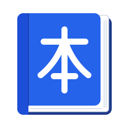

#  toshokan

A REST API for running a library's inventory: the catalog of titles, the physical copies on the shelves, the
members who borrow them, and the lending desk (loans, returns, renewals, loan history and the overdue list).

Built with Spring Boot 4.1 on Java 21, with Cassandra 4.1 for storage.

## Running it

You need Java 21 and Docker.

```shell
mvn -pl toshokan-app -am spring-boot:run
```

Or run `ToshokanApplication` from IntelliJ. Either way, Cassandra starts by itself from `compose.yaml`, and the
tables are created on startup. The first start can take a minute or two while Cassandra boots.

Once it's up:

- API: `http://localhost:8080/toshokan/api/v1`
- Swagger UI: http://localhost:8080/toshokan/swagger-ui.html

## Configuration

Set these in `toshokan-app/src/main/resources/application.properties`.

| Property                            | Default           | Meaning                                       |
|-------------------------------------|-------------------|-----------------------------------------------|
| `toshokan.time-zone`                | the server's zone | The library's time zone, used for due dates   |
| `toshokan.lending.loan-period`      | `14d`             | How long a loan (or a renewal) lasts          |
| `toshokan.lending.max-renewals`     | `2`               | How many times a loan can be renewed          |
| `toshokan.lending.max-active-loans` | `3`               | How many books a member can have out at once  |

## Modules

| Module                 | What it holds                                                   |
|------------------------|-----------------------------------------------------------------|
| `toshokan-shared`      | Error handling, paging tokens, the library clock                |
| `toshokan-catalog`     | Titles: creating, fetching, searching and deleting books        |
| `toshokan-inventory`   | Physical copies and the holdings list                           |
| `toshokan-members`     | Library members and their cards                                 |
| `toshokan-circulation` | Lending, returns, renewals, loan history and the overdue list   |
| `toshokan-app`         | The runnable app and the integration tests                      |

## More documentation

- [API guide](docs/api.md): every endpoint, the lending rules, paging, errors, and a walkthrough with curl
- [Design notes](docs/design.md): the Cassandra tables and how they're kept consistent
- [Development](docs/development.md): running the tests and handling schema changes
